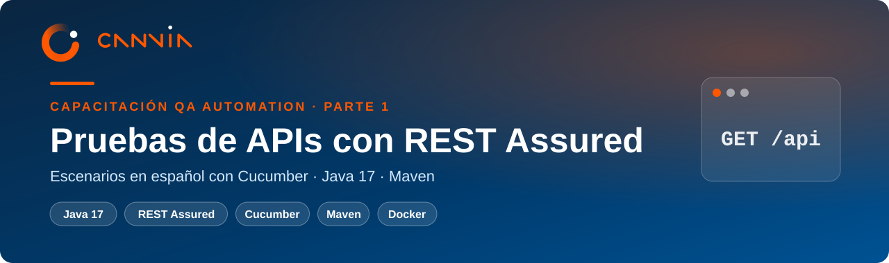
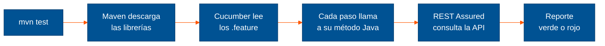
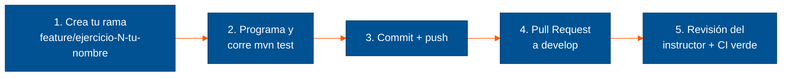

<div align="center">



<br/>

[](https://github.com/gpalominoh-canvia/canvia-restassured-bdd/actions/workflows/ci.yml)


**Capacitación QA Automation · Parte 1 de 2**<br/>
Aprende a probar APIs automáticamente escribiendo los casos de prueba en español.

[Empezar](#empieza-aquí-elige-tu-camino) ·
[Ejecutar](#ejecutar-las-pruebas) ·
[Documentación](docs/README.md) ·
[Git y GitHub](docs/04-git-y-github.md)

</div>

---

## ¿Qué vas a aprender?

Una **API** es la "puerta trasera" por la que dos sistemas se hablan: la app del banco le pide tu saldo al
servidor, y el servidor le responde. **Probar una API** es comprobar que esas respuestas sean correctas,
sin abrir ninguna pantalla.

En este curso automatizas esas pruebas: escribes **qué** debe pasar en español, y el código Java lo
comprueba solo, en segundos, cada vez que lo necesites.

> **En una frase:** escribes el caso de prueba como lo contarías a un compañero, y la computadora lo ejecuta.

```gherkin
Escenario: Consultar una reserva recién creada
  Dado que existe una reserva a nombre de "Rosa"
  Cuando consulto esa reserva
  Entonces el código de respuesta es 200
  Y la respuesta contiene el campo "firstname"
```

Ese texto es una prueba real de este proyecto. Corre contra [Restful Booker](https://restful-booker.herokuapp.com),
una API pública de reservas de hotel hecha para practicar.

### Las piezas, explicadas como una cocina

| Pieza | En la cocina sería... | Qué hace aquí |
|---|---|---|
| **Java 17** | la electricidad | Ejecuta todo el código |
| **Maven** | el proveedor | Descarga las librerías y corre las pruebas con `mvn test` |
| **VS Code** | la mesa de trabajo | El editor donde escribes y ejecutas |
| **REST Assured** | el cuchillo | Envía las peticiones a la API y revisa las respuestas |
| **Cucumber** | la receta | Convierte los escenarios en español en pasos ejecutables |

---

## Empieza aquí: elige tu camino

| Tu situación | Qué hacer | Tiempo |
|---|---|---|
| **Quiero dejar mi PC lista** (recomendado) | Sigue la [instalación en Windows, paso a paso](docs/01-instalacion-windows-paso-a-paso.md) | 30–45 min |
| **No pude instalar Java o Maven** | Abre Docker Desktop y haz doble clic en **`iniciar-entorno.bat`** ([cómo funciona](docs/02-entorno-docker-alumnos.md)) | 10 min |
| **Nunca usé Git ni GitHub** | Lee [Git y GitHub desde cero](docs/04-git-y-github.md) | 20 min |
| **Soy el instructor** | Prepara la demo con [Windows en Docker](docs/03-windows-en-docker-instructor.md) | — |

¿Usas macOS o Linux? El [manual de instalación en PDF](docs/pdf/manual-instalacion-restassured-cucumber.pdf)
tiene una columna para cada sistema.

---

## Ejecutar las pruebas

Con tu PC lista (o dentro del entorno Docker), abre la terminal en la carpeta del proyecto:

```powershell
mvn test
```

**Lo que debes ver al final:**

```text
[INFO] Tests run: 4, Failures: 0, Errors: 0, Skipped: 0
[INFO] BUILD SUCCESS
```

Si ves eso, todo funciona. El reporte con el detalle de cada escenario queda en `target/cucumber-report.html`
(ábrelo con doble clic).

| Quiero... | Comando |
|---|---|
| Correr todo | `mvn test` |
| Correr solo los escenarios marcados `@smoke` | `mvn test "-Dcucumber.filter.tags=@smoke"` |
| Excluir una etiqueta | `mvn test "-Dcucumber.filter.tags=not @seguridad"` |
| Probar contra otra URL | `mvn test "-DbaseUrl=http://localhost:3001"` |

> En PowerShell los parámetros `-D...` van **entre comillas**. Sin comillas aparece el error
> `Unknown lifecycle phase`.

### ¿Qué pasa cuando escribes `mvn test`?



---

## ¿Qué hay en esta carpeta?

```text
canvia-restassured-bdd/
├── src/test/resources/features/   ← los escenarios en español (.feature). Empieza leyendo aquí
├── src/test/java/com/canvia/qa/
│   ├── steps/                     ← el código Java detrás de cada frase del escenario
│   ├── support/                   ← configuración común (URL de la API, datos compartidos)
│   └── runners/                   ← el "botón de arranque" que usa Maven
├── pom.xml                        ← la lista de librerías y sus versiones
├── iniciar-entorno.bat            ← entorno listo en Docker (doble clic)
├── docker/windows/                ← Windows 11 en Docker para la demo del instructor
└── docs/                          ← guías y PDF del curso
```

---

## Documentación

| Guía | Para qué sirve |
|---|---|
| [1 · Instalación en Windows, paso a paso](docs/01-instalacion-windows-paso-a-paso.md) | Instalar Java, Maven, Git y VS Code, y ver las pruebas en verde |
| [2 · Entorno listo en Docker](docs/02-entorno-docker-alumnos.md) | Trabajar sin instalar nada (solo Docker Desktop) |
| [3 · Windows en Docker](docs/03-windows-en-docker-instructor.md) | Instructor: demo en vivo sobre un Windows limpio |
| [4 · Git y GitHub](docs/04-git-y-github.md) | Configurar Git, conectar tu cuenta y entregar ejercicios |
| [Manual de instalación (PDF)](docs/pdf/manual-instalacion-restassured-cucumber.pdf) | Versión completa para Windows, macOS y Linux |
| [Manual del entorno Docker (PDF)](docs/pdf/manual-entorno-docker-restassured.pdf) | Entorno del alumno y Windows en Docker, listo para imprimir |
| [Manual de Git y GitHub (PDF)](docs/pdf/manual-git-github.pdf) | La guía de Git en formato para imprimir |
| [Presentación del curso (PDF)](docs/pdf/presentacion-restassured-cucumber.pdf) | Láminas de clase y los 5 ejercicios |

---

## Cómo entregar un ejercicio



- **`develop`** es la rama de trabajo del curso; **`main`** guarda las versiones estables.
- Nadie sube directo a `develop` ni a `main`: todo entra por Pull Request, con la CI en verde y la aprobación del instructor.
- Los comandos exactos están en [Git y GitHub → El flujo de cada ejercicio](docs/04-git-y-github.md#6-el-flujo-de-cada-ejercicio).

---

## ¿Algo no funciona?

1. Revisa la tabla **"Si algo falla"** al final de la [instalación paso a paso](docs/01-instalacion-windows-paso-a-paso.md#si-algo-falla).
2. Si el problema es de Git (`403`, `Permission denied`), mira [errores frecuentes de Git](docs/04-git-y-github.md#8-errores-frecuentes).
3. Si sigues trabado, usa el [entorno listo en Docker](docs/02-entorno-docker-alumnos.md) para no perder la clase, y
   avísale al instructor con una captura del error.

<details>
<summary><strong>Versiones exactas del proyecto</strong></summary>

| Herramienta | Versión |
|---|---|
| Java (Eclipse Temurin) | 17 |
| Maven | 3.9 |
| REST Assured | 6.3.0 |
| Cucumber-JVM | 7.34.9 |
| JUnit Platform | 6.1.3 |
| Jackson Databind | 2.20.0 |

</details>

---

<div align="center">

<a href="https://canvia.com"></a>

**Capacitación QA Automation** · Parte 1: APIs con REST Assured ·
Parte 2: [Web con Playwright](https://github.com/gpalominoh-canvia/canvia-playwright-bdd)

<sub>Material de uso interno para la capacitación de Canvia.</sub>

</div>
