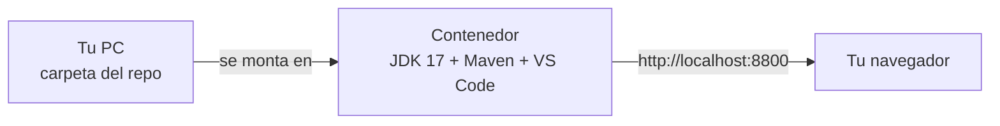

# Entorno listo en Docker (para alumnos)

> Versión para imprimir: [PDF con formato Canvia](pdf/manual-entorno-docker-restassured.pdf).

Si tu PC no logra instalar Java o Maven (permisos, proxy, versión vieja de Java), usa este entorno:
con **un doble clic** levanta un contenedor con JDK 17, Maven 3.9 y VS Code con las extensiones del curso,
y lo abre en tu navegador. Trabajas sobre los archivos de esta misma carpeta.



## Requisitos

- **Docker Desktop** instalado y abierto: <https://www.docker.com/products/docker-desktop/>
  (en Windows pide activar WSL 2; acepta y reinicia).
- 8 GB de RAM y ~4 GB libres en disco.
- El repositorio clonado o descargado (botón verde **Code → Download ZIP** en GitHub).

## Uso

### Windows

1. Abre Docker Desktop y espera a que diga **Engine running**.
2. En la carpeta del repo, doble clic en **`iniciar-entorno.bat`**.
3. Espera. La primera vez tarda entre 5 y 10 minutos (descarga la imagen y las librerías).
4. Se abre el navegador en <http://localhost:8800> con VS Code y el proyecto.

### macOS / Linux

```bash
./iniciar-entorno.sh
```

## Trabajar dentro del entorno

Abre la terminal de VS Code (menú ☰ → *Terminal → New Terminal*) y ejecuta:

```bash
mvn test
mvn test "-Dcucumber.filter.tags=@smoke"
```

- Todo lo que edites se guarda en la carpeta del repo de tu PC: si apagas el contenedor no pierdes nada.
- El reporte queda en `target/cucumber-report.html`; ábrelo desde tu PC con doble clic.
- Las librerías de Maven se guardan en un volumen de Docker (`maven-cache`): la segunda vez arranca rápido.

## Apagar y volver a encender

| Acción | Cómo |
|---|---|
| Apagar | doble clic en `detener-entorno.bat` (o `docker compose down`) |
| Encender otra vez | doble clic en `iniciar-entorno.bat` |
| Ver qué pasa por dentro | `docker compose logs -f entorno` |
| Reconstruir desde cero | `docker compose build --no-cache` y luego `iniciar-entorno.bat` |
| Borrar todo (incluye librerías descargadas) | `docker compose down -v --rmi local` |

## Git dentro del entorno

Lo más simple es **hacer `commit` y `push` desde tu PC** (terminal o VS Code local) sobre la misma carpeta:
los cambios que hiciste en el navegador ya están ahí. Si quieres usar Git dentro del contenedor, configura
primero tu nombre y correo (ver [Git y GitHub](04-git-y-github.md#3-configurar-git-una-sola-vez-por-pc)).

## Problemas comunes

| Síntoma | Solución |
|---|---|
| `Docker Desktop no esta abierto` | Abre Docker Desktop y espera a **Engine running**. |
| `port is already allocated` (8800 ocupado) | Cambia en `docker-compose.yml` la línea `127.0.0.1:8800:8080` por `127.0.0.1:8810:8080` y abre <http://localhost:8810>. |
| `WSL 2 installation is incomplete` | En PowerShell como admin: `wsl --install`, reinicia la PC. |
| `Virtualization must be enabled` | Activa la virtualización (Intel VT-x / AMD-V) en la BIOS. |
| Descarga lenta o `Connect timed out` | Red corporativa: pide a Mesa de Ayuda el proxy y configúralo en Docker Desktop → *Settings → Resources → Proxies*. |
| VS Code en el navegador no carga extensiones | Recarga la página (`F5`). Si sigue, reconstruye la imagen. |

---

Anterior: [Instalación paso a paso](01-instalacion-windows-paso-a-paso.md) · [Índice](README.md) · Siguiente: [Windows en Docker](03-windows-en-docker-instructor.md)
