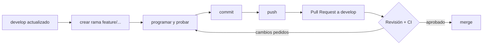

# Git y GitHub: lo mínimo para trabajar en el curso

> Versión para imprimir: [PDF con formato Canvia](pdf/manual-git-github.pdf).

Esta guía te lleva desde una PC sin Git hasta entregar tu primer ejercicio con un Pull Request.
No necesitas saber nada antes. Sigue las secciones en orden la primera vez; después usa la
[chuleta](#9-chuleta-de-comandos) del final.

| | |
|---|---|
| **Git** | Programa en tu PC que guarda el historial de cambios de una carpeta (el *repositorio*). |
| **GitHub** | Página web donde vive la copia compartida del repositorio. Ahí se revisan y aprueban los cambios. |
| **Commit** | Una "foto" de tus cambios con un mensaje que explica qué hiciste. |
| **Rama (branch)** | Una línea de trabajo paralela. Trabajas en tu rama sin tocar la de los demás. |
| **Pull Request (PR)** | Pedido para que tus cambios entren a la rama principal. El instructor lo revisa ahí. |

---

## 1. Crear tu cuenta de GitHub

1. Entra a <https://github.com/signup> y crea la cuenta. Usa un nombre de usuario profesional
   (por ejemplo `nombre-apellido`); lo verán otras personas.
2. Confirma el correo.
3. Recomendado: activa la verificación en dos pasos en **Settings → Password and authentication**.
4. Envía tu usuario al instructor para que te dé acceso al repositorio del curso.

---

## 2. Instalar Git

### Windows

```powershell
winget install --id Git.Git -e
```

O descarga el instalador de <https://git-scm.com/download/win> y deja todas las opciones por defecto.
Cierra y vuelve a abrir la terminal.

### macOS

```bash
xcode-select --install     # trae Git
# o, si usas Homebrew:
brew install git
```

### Linux

```bash
sudo apt install git       # Ubuntu / Debian
sudo dnf install git       # Fedora
```

### Comprobar

```bash
git --version
# git version 2.5x.x
```

---

## 3. Configurar Git (una sola vez por PC)

Git firma cada commit con tu nombre y correo. Usa **el mismo correo de tu cuenta de GitHub**,
así tus commits aparecen enlazados a tu perfil.

```bash
git config --global user.name "Nombre Apellido"
git config --global user.email "tu-correo@ejemplo.com"
git config --global init.defaultBranch main
git config --global pull.rebase false
```

Solo en **Windows**, para que los saltos de línea no ensucien los cambios:

```powershell
git config --global core.autocrlf true
```

Solo en **macOS / Linux**:

```bash
git config --global core.autocrlf input
```

Para usar VS Code como editor de Git (mensajes largos, conflictos):

```bash
git config --global core.editor "code --wait"
```

Revisa todo con:

```bash
git config --global --list
```

---

## 4. Conectar tu PC con GitHub

GitHub ya no acepta tu contraseña desde la terminal. Elige **una** de estas opciones.

### Opción A (recomendada): GitHub CLI

Es la más simple: abre el navegador, apruebas y listo.

```powershell
winget install --id GitHub.cli -e        # Windows
brew install gh                          # macOS
sudo apt install gh                      # Ubuntu / Debian
```

Cierra y abre la terminal, y luego:

```bash
gh auth login
```

Responde así:

```text
? Where do you use GitHub?                 GitHub.com
? What is your preferred protocol?          HTTPS
? Authenticate Git with your credentials?   Yes
? How would you like to authenticate?       Login with a web browser
```

Copia el código de 8 caracteres que aparece, pégalo en el navegador y autoriza. Comprueba:

```bash
gh auth status
# ✓ Logged in to github.com account tu-usuario
```

### Opción B: Git Credential Manager (solo Windows)

Viene con Git para Windows. La primera vez que hagas `git clone` o `git push` de un repo privado,
se abre una ventana para iniciar sesión en GitHub. No tienes que hacer nada más.

### Opción C: llave SSH

Útil si tu red corporativa bloquea el inicio de sesión por navegador.

```bash
ssh-keygen -t ed25519 -C "tu-correo@ejemplo.com"
# Enter a todo (ruta por defecto). Puedes dejar la frase vacía.
```

Copia la llave **pública**:

```powershell
Get-Content $env:USERPROFILE\.ssh\id_ed25519.pub | Set-Clipboard   # Windows
```

```bash
pbcopy < ~/.ssh/id_ed25519.pub        # macOS
cat ~/.ssh/id_ed25519.pub             # Linux: copia lo que salga
```

Pégala en GitHub → **Settings → SSH and GPG keys → New SSH key**. Prueba:

```bash
ssh -T git@github.com
# Hi tu-usuario! You've successfully authenticated...
```

Con SSH, clona con la URL `git@github.com:organizacion/repo.git` en lugar de la `https://`.

> **Nunca** compartas la llave privada (`id_ed25519` sin `.pub`) ni pegues tokens en el chat o en el código.

---

## 5. Traer el repositorio del curso

Elige una carpeta de trabajo **sin espacios ni tildes** (por ejemplo `C:\cursos`) y clona:

```bash
cd C:\cursos
git clone https://github.com/<organizacion>/<repositorio>.git
cd <repositorio>
code .
```

`git clone` descarga el proyecto completo con su historial. Solo se hace una vez.

---

## 6. El flujo de cada ejercicio

Así se trabaja en el curso (es el mismo flujo que en un equipo real):



### 6.1 Actualizar `develop` y crear tu rama

```bash
git switch develop
git pull
git switch -c feature/ejercicio-1-nombre-apellido
```

Nombre de rama: `feature/<ejercicio>-<tu-nombre>`, en minúsculas y con guiones.

### 6.2 Trabajar y revisar qué cambió

```bash
git status            # qué archivos cambiaron
git diff              # qué líneas cambiaron
```

Corre las pruebas antes de guardar tus cambios. Si no pasan en tu PC, no pasarán en la CI.

### 6.3 Guardar un commit

```bash
git add src/                      # agrega lo que quieres incluir
git status                        # verifica que solo vaya lo correcto
git commit -m "feat: agrega escenario de login con usuario bloqueado"
```

Mensajes de commit en español con el formato *Conventional Commits*:

| Prefijo | Cuándo |
|---|---|
| `feat:` | agregas un escenario, step o funcionalidad |
| `fix:` | corriges algo que fallaba |
| `refactor:` | reordenas código sin cambiar lo que hace |
| `test:` | solo cambias pruebas o datos de prueba |
| `docs:` | cambias documentación o README |
| `chore:` | configuración, dependencias, archivos varios |

Haz commits pequeños: uno por idea. Es más fácil revisar cinco commits claros que uno gigante.

### 6.4 Subir tu rama

La primera vez:

```bash
git push -u origin feature/ejercicio-1-nombre-apellido
```

Las siguientes, solo `git push`.

### 6.5 Abrir el Pull Request

Desde la web: GitHub muestra el botón **Compare & pull request** apenas subes la rama.
Comprueba que diga **base: `develop`** ← **compare: tu rama**.

Desde la terminal:

```bash
gh pr create --base develop --title "feat: ejercicio 1 - Nombre Apellido" --body "Closes #1"
```

`Closes #1` enlaza el PR con el Issue del ejercicio y lo cierra al aprobarse.

### 6.6 Corregir lo que pida la revisión

No abras otro PR. Sigue en la misma rama:

```bash
# corriges los archivos
git add .
git commit -m "fix: aplica comentarios de la revisión"
git push
```

El PR se actualiza solo.

### 6.7 Traer cambios nuevos de `develop` a tu rama

Si el instructor actualizó `develop` mientras trabajabas:

```bash
git switch develop
git pull
git switch feature/ejercicio-1-nombre-apellido
git merge develop
```

---

## 7. Resolver un conflicto

Un conflicto ocurre cuando tú y otra persona cambiaron las mismas líneas. Git marca el archivo así:

```text
<<<<<<< HEAD
lo que tienes tú
=======
lo que viene de develop
>>>>>>> develop
```

1. Abre el archivo en VS Code: aparecen los botones **Accept Current / Accept Incoming / Accept Both**.
2. Deja el código como debe quedar y borra las marcas `<<<<<<<`, `=======`, `>>>>>>>`.
3. Corre las pruebas.
4. Termina:

```bash
git add <archivo>
git commit -m "chore: resuelve conflicto con develop"
git push
```

---

## 8. Errores frecuentes

| Mensaje | Qué pasa | Solución |
|---|---|---|
| `Permission denied (403)` o `Permission to ... denied to otro-usuario` | Git usa otra cuenta guardada en la PC | `gh auth status` y `gh auth login`. En Windows también: `cmdkey /delete:git:https://github.com` y vuelve a hacer `push`. |
| `Support for password authentication was removed` | Intentaste usar tu contraseña | Configura la sección 4. |
| `fatal: not a git repository` | Estás en otra carpeta | `cd` a la carpeta del repo (donde está `.git`). |
| `! [rejected] ... (fetch first)` | Hay commits en GitHub que no tienes | `git pull` y luego `git push`. |
| `Your local changes would be overwritten` | Tienes cambios sin guardar al cambiar de rama | Haz commit, o `git stash`, cambia de rama y `git stash pop`. |
| `Author identity unknown` | Falta tu nombre y correo | Sección 3. |
| Subí `target/`, `node_modules/` o `reports/` | Faltaba en `.gitignore` | `git rm -r --cached target` y commit. El `.gitignore` del repo ya los excluye. |
| Commit en la rama equivocada (aún sin `push`) | Trabajaste en `develop` | `git switch -c feature/mi-rama`: tus commits se van a la rama nueva. Luego avisa al instructor. |

> Nunca uses `git push --force` en `develop` o `main`. Si crees que lo necesitas, pregunta primero.

---

## 9. Chuleta de comandos

```bash
# Configuración (una vez)
git config --global user.name "Nombre Apellido"
git config --global user.email "correo@ejemplo.com"
gh auth login

# Empezar
git clone <url>
git switch develop && git pull
git switch -c feature/<ejercicio>-<nombre>

# Día a día
git status
git diff
git add <archivos>
git commit -m "feat: ..."
git push                      # la primera vez: git push -u origin <rama>

# Ver historial
git log --oneline --graph -15

# Ramas
git branch                    # ramas locales
git switch <rama>             # cambiar de rama
git merge develop             # traer develop a tu rama

# Deshacer (sin peligro)
git restore <archivo>         # descarta cambios no guardados de un archivo
git restore --staged <archivo>   # lo saca del próximo commit
git commit --amend            # corrige el mensaje del último commit (solo si aún no hiciste push)

# Pull Request
gh pr create --base develop
gh pr status
gh pr checks                  # estado de la CI
```

---

## 10. Git desde VS Code

Todo lo anterior también se puede hacer con clics en la vista **Source Control** (`Ctrl+Shift+G`):

- **+** junto a un archivo = `git add`.
- Mensaje + **Commit** = `git commit`.
- **Sync Changes** = `git pull` + `git push`.
- Abajo a la izquierda aparece la rama actual: clic para cambiar o crear una.

Recomendación: aprende primero los comandos. Cuando algo falla, la terminal te dice exactamente qué pasó.

---

Anterior: [Windows en Docker](03-windows-en-docker-instructor.md) · [Índice](README.md)
